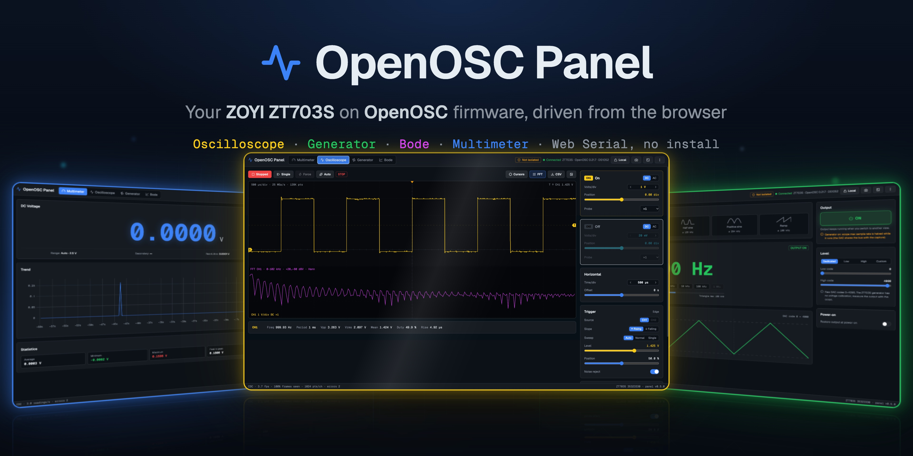

# OpenOSC Panel

**Your ZOYI ZT703S on OpenOSC firmware, driven from the browser.** Oscilloscope, signal
generator, Bode plotter and multimeter on a big screen, over one USB cable. No drivers, no
install, no backend. Your data never leaves your machine.

[](https://github.com/Fyfar/openosc-panel/actions/workflows/ci.yml)
[](https://github.com/Fyfar/openosc-panel/blob/main/package.json)
[](./LICENSE)




### **[Open the app →](https://fyfar.github.io/openosc-panel/)**

> [!IMPORTANT]
> This panel works **only with the [OpenOSC](https://github.com/bve/OpenOSC) firmware**. The
> stock ZOYI firmware has no remote control over USB. Still on stock firmware? See
> [below](#stock-firmware).

## Features

### Multimeter

- **Up to a week of continuous logging**, 1.8 million readings, with the whole run on the chart
  and every spike and overload still visible.
- **Your measurements are safe.** After a page reload, a tab or browser crash or a power cut, the
  panel offers to restore the recording and you carry on logging.
- **Start and stop logging on the reading itself**: log only while a current is above or a
  voltage below a value you set, once or every time it happens. No need to watch the meter.
- Trend chart, histogram and statistics describe exactly the readings you logged; one click
  exports them as CSV.

### Oscilloscope

- The device's own measurements (frequency, Vpp, RMS, duty and more) and the hardware frequency
  counter on each channel.
- **An FFT you can measure on:** peak frequency and level, two markers for differences, and plain
  notes on the panel when a spectrum can't be trusted.
- **Catch glitches and bad pulses** with Pulse width, Runt and Rise/fall triggers: set the
  polarity, the levels and a time limit like `50us` (OpenOSC 0.21.19 or newer).
- Export the full capture record as CSV, not just what's on screen.

### Bode plot

- **One click sweeps the generator** and re-ranges each channel as the gain changes, then reads off
  the −3 dB corner and roll-off.
- Sets the scope up for the sweep itself, whatever you left it at, and puts your scope and
  generator settings back when it's done, trigger included.

### Generator

- Type frequencies the way you say them: `10k`, `2.5 MHz`, `500 mHz`.
- Keeps running while you work in another view.

### Everywhere

- **Control the device from your computer.** The settings you'd otherwise dig for with the small
  screen and buttons (timebase, volts per division, trigger, meter function and range, generator
  shape and level) are a click away on a big screen, and changes made on the device's own
  buttons show up in the panel too.
- Lock the device's buttons while you work from the computer, and save a picture of the device's
  own screen.
- The panel switches the device between its scope and multimeter modes for you, in about a
  second.
- For advanced users: a console to send the firmware's text commands (SCPI) directly.
- Install it as an app from the browser's address bar: no installer, and it works offline once
  you've opened it online.

## What you need

- A **ZOYI ZT703S** with **OpenOSC 0.21.4 or newer** (tested on 0.21.4 to 0.21.19). Older or
  unrecognised firmware gets a warning before connecting, and features it lacks stay off. The
  **ZT706S** should work too, but nobody has tried it on real hardware yet. Reports welcome.
- **OpenOSC 0.21.9 or newer is recommended:** the scope updates about three times faster,
  short glitches stay visible on long captures, and the measurements come from the device
  itself. Older firmware still works, with measurements computed in the browser.
- On the device: USB on in *Settings → Files & USB*, and performance profile 200/100 (faster
  profiles switch USB off).
- **Chrome, Edge, Opera or Firefox 151+ on desktop.** Safari and iOS have no Web Serial.

> [!CAUTION]
> **The USB port is not isolated.** Probe ground is tied to your computer's ground. Never
> measure mains while the cable is in.

## Stock firmware?

The stock firmware has no remote control, so the panel can't connect to it. Two options:

- **Keep it and use [Multimeter·Live](https://github.com/Fyfar/multimeter-live)**
  ([open the app](https://fyfar.github.io/multimeter-live/)). It reads the multimeter through
  the meter's serial output over a USB-UART adapter or Bluetooth. Multimeter only: no scope,
  generator or control.
- **Install OpenOSC.** The [OpenOSC README](https://github.com/bve/OpenOSC#installation) and
  [wiki](https://github.com/bve/OpenOSC/wiki/Installation) cover installing it and going back
  to stock. Flashing firmware is at your own risk.

## Good to know

- Scope and multimeter can't run at the same time: they are separate USB profiles on the
  device. The generator keeps running across the switch.
- The multimeter recording is kept until you press **Clear data**. At 1.8 million readings
  logging stops: export the CSV, then clear to start a new one.
- Settings, scope captures and Bode results are not saved between visits.
- Each online launch loads the latest version. If a new one comes out while the panel is open,
  it asks first (**Update** / **Later**) and never reloads on its own, so an unsaved log is safe.
- One device, one tab: the serial port is exclusive.

> Independent project, not affiliated with ZOYI or ZOTEK, and separate from the OpenOSC
> firmware project. Product names are used only to identify the hardware.

## Run it yourself

The quickest way is the [live app](https://fyfar.github.io/openosc-panel/). To run it locally:

```sh
npm install
npm run dev
```

Open [http://localhost:5173](http://localhost:5173) and click **Connect device**.

To host your own copy, run `npm run build` and serve `dist/` from any static host with HTTPS.
On GitHub: fork the repo, set *Settings → Pages → Source* to **GitHub Actions**, then run
*Actions → Deploy to GitHub Pages → Run workflow*.

## Contributing

Issues and pull requests are welcome, ZT706S reports most of all. Before sending code, run
`npm run build`, `npm run check` and `npx fallow`.

## License

[MIT](./LICENSE)
